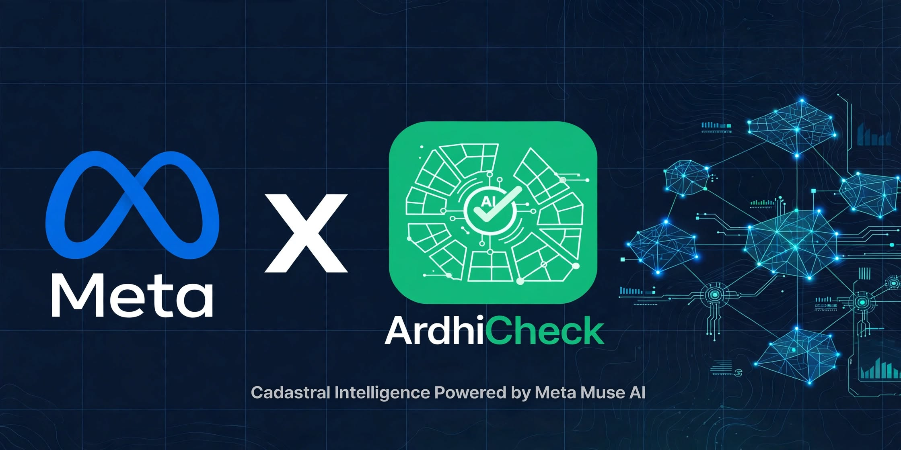

<p align="center">
  
</p>

<p align="center">
  
</p>

<p align="center">
  <a href="https://ardhicheck-ivory.vercel.app"></a>
  
  
  
</p>

---

# ArdhiCheck

> Photograph a Kenyan land survey deed plan and get an automated verification screening audit in seconds: does the paperwork add up mathematically, and does the plot sit on protected land?

Built during the **Meta Global AI Developer Hackathon** (Oct 26 – Nov 4, 2026).  
Live Production: **[https://ardhicheck-ivory.vercel.app](https://ardhicheck-ivory.vercel.app)**

---

## Problem

Kenyan land buyers often commit life savings on the strength of a survey plan they cannot interpret. Survey deed plans may contain clerical bearing transpositions that prevent the perimeter from closing, stated acreage that disagrees with the ground coordinates, or mixed local datums. Plots may also encroach onto gazetted riparian corridors, road wayleaves, or public forest reserves. Professional verification through licensed surveyors and advocates is essential, but buyers frequently enter purchase agreements without checking if the paperwork is internally consistent.

ArdhiCheck bridges this gap: upload a survey plan or enter readings, get an automated verification audit in seconds, and know whether the paperwork closes mathematically—with exact numerical evidence and specific questions to ask a licensed surveyor.

## Demo

- **Live Web Application:** [https://ardhicheck-ivory.vercel.app](https://ardhicheck-ivory.vercel.app)
- **Demo Video:** [Walkthrough Video (YouTube)](https://youtu.be/7YRuMupKd90)

## Meta Technologies Used

ArdhiCheck integrates official Meta models and architectures across its verification pipeline:

| Technology / Model | Role in Pipeline | Endpoint / Runtime |
|---|---|---|
| **Meta Muse Spark 1.3** (muse-spark-1.3) | Multimodal survey deed plan extraction & structured output; plain-language audit report synthesis | Meta Model API (https://api.meta.ai/v1) & cloud inference |
| **Meta SAM 3.1** (sam-3.1) | Text-prompted segmentation of aerial imagery for riparian buffers (evaluated on synthetic fixtures) | Meta Model API (https://api.meta.ai/v1) |
| **Meta Muse Spark Open** (muse-spark-open) | Self-hosted open-weights fallback option for edge and private server deployments | Custom OpenAI-compatible runtime / Local GPU |

- **Demo Walkthrough Attribution**: The video walkthrough and live production app run on **Meta Muse Spark 1.3** cloud inference.
- **Satellite Map Screening**: The interactive map runs deterministic statutory buffer algorithms under EMCA Cap 387 against high-resolution Esri World Imagery; SAM 3.1 segmentation was benchmarked on synthetic aerial fixtures.
- **Zero-Credential Replay**: When running without active cloud API keys, ArdhiCheck switches cleanly to offline pre-recorded replays, explicitly flagging Offline replay (pre-recorded) across all UI badges.

## How It Works

1. **Multimodal Document Extraction** – Upload a photo/PDF of an official Kenyan survey deed plan (or select a benchmark scenario). **Meta Muse Spark 1.3** extracts the parcel number, stated acreage, datum, and the schedule of boundary bearings and distances into structured JSON.
2. **Pure Geometric Verification** – Deterministic Python algorithms (`app.geo.*`, consuming zero tokens) compute traverse coordinates, Bowditch adjustment, shoelace polygon area, and Arc 1960 datum transformations under Survey Act Cap 299.
3. **Clerical Blunder Diagnosis** – When a traverse miscloses beyond tolerance, ArdhiCheck simulates single-digit substitutions and adjacent-digit transpositions across printed bearings and distances to rank-order probable typos.
4. **Satellite & Reserve Screening** – **Meta SAM 3.1** inspects aerial imagery for protected riparian and road corridors. An interactive cadastral map screens against gazetted reserves with a user-configurable riparian buffer width (6m to 50m).
5. **No Invented Geometry** – If an uploaded document is a Title Deed without an explicit bearing/distance schedule, ArdhiCheck returns **CANNOT VERIFY**, marks closure and area as not applicable, and lists due diligence steps to obtain the Survey of Kenya Registry Index Map (RIM).
6. **Report & Provenance** – Outputs an executive audit verdict (GREEN / AMBER / RED / CANNOT VERIFY), mathematical evidence, specific questions to ask the licensed surveyor, and complete execution provenance (model, latency, tokens, request ID) for every field.

The model reads and explains; **pure code calculates**. Every finding in the report cites the exact mathematical calculation behind it.

## Evaluation Results

ArdhiCheck includes a deterministic benchmark suite in [eval/](eval/) evaluating **20 synthetic cadastral test plans** with known ground truths across 4 error classes (clean traverses, single-digit clerical typos, gross misclosures, and stated area deficits):

| Evaluation Dimension | Measured Result | Specification / Methodology |
|---|---|---|
| **Traffic-Light Verdict Accuracy** | **95.0%** (19/20) | Illustrative statutory thresholds (GREEN, AMBER, RED) |
| **Traverse Closure Accuracy (Bowditch)** | **100.0%** (20/20) | Strict mathematical closure agreement (< 0.05 m tolerance) |
| **Area Discrepancy Detection** | **100.0%** (5/5) | Shoelace polygon area vs stated acreage (> 3% threshold) |
| **Blunder Localisation (Rank-1 Typo)** | **60.0%** (3/5) | Combinatorial single-digit substitution and transposition ranker |
| **Tokens Consumed for Geometry** | **0 tokens** | Pure Python floating-point math at zero inference cost |
| **Average Geometry Latency** | **< 3 ms** | Local pure Python execution per survey plan |
| **Automated Test Suite** | **120 Passing Tests** | Full pytest coverage across pipeline, geometry, and API |

See [eval/results.md](eval/results.md) for full case-by-case evaluation data. Run locally via python -m eval.run_eval.

## Configurable Screening Settings

- **Traverse Misclosure Tolerance**: Configurable in UI and API (illustrative default: 1:5,000 relative precision threshold and 0.30m linear misclosure, referencing Survey Act Cap 299 peri-urban guidelines; to be confirmed with a licensed land surveyor).
- **Riparian Buffer Setback**: Configurable from 6m to 50m (illustrative default: 30m referencing EMCA Cap 387 guidelines for rivers and permanent watercourses; subject to statutory determination by WRMA/NEMA).
- **Stated Area Discrepancy Margin**: Illustrative default 2.0% – 3.0% threshold between computed shoelace boundary polygon and stated deed acreage.

## Run Locally

```bash
# Clone repository
git clone https://github.com/JasonMomanyi/ArdhiCheck.git
cd ArdhiCheck

# Setup virtual environment
python -m venv .venv
.\.venv\Scripts\activate      # Windows (.venv/bin/activate on macOS/Linux)

# Install dependencies
pip install -e .

# Run test suite & linter
python -m pytest
python -m ruff check .

# Run evaluation benchmark
python -m eval.run_eval

# Start the ArdhiCheck Web Application
python -m app.server 8000
# Open http://127.0.0.1:8000 in your browser
```

## Built During the Hackathon

All code in this repository was developed between 26 Oct and 4 Nov 2026 for the Meta Global AI Developer Hackathon. An AI coding agent was used for scaffolding and implementation assistance (see [PROVENANCE.md](PROVENANCE.md)).

## Limitations & Legal Disclaimers

- **Not legal advice.** ArdhiCheck is an engineering due diligence tool. It audits what was calculated and what was found.
- **Zero buyer investment recommendations.** The system provides mathematical audits and statutory parameters, not purchasing, pricing, or valuation advice.
- **Not affiliated with the Ministry of Lands or Ardhisasa.** It does not perform title register searches or access confidential land registry archives.
- **Not a replacement for a licensed surveyor.** Ground beacon relocation and statutory boundary re-establishment must be performed by a surveyor licensed under the Survey Act (Cap 299).
- Arc 1960 → WGS84 transforms are accurate to metres only; the app includes an uncertainty note and never claims sub-centimetre precision.
- Benchmark survey deed plans and satellite clips are synthetic test fixtures designed to evaluate boundary closure and reserve overlap. Sample documents used during verification testing have all personal identifiers, crucial owner details, and sensitive attributes redacted or blurred to protect personal privacy.
- Development screenshots in 
ecordings/screenshots/ depict benchmark replay captures during algorithmic testing.

## Licences & Layer Attribution

| Layer / Dependency | Licence | Attribution |
|---|---|---|
| Python runtime | PSF | Python Software Foundation |
| numpy | BSD-3-Clause | NumPy developers |
| pyproj | MIT | PROJ / pyproj contributors |
| shapely | BSD-3-Clause | Shapely contributors |
| httpx | BSD-3-Clause | Encode OSS |
| pillow | HPND | Secret Labs AB / Pillow contributors |
| pytest, ruff | MIT | pytest-dev, Astral |
| Esri World Imagery | Developer Evaluation | © Esri, Maxar, Earthstar Geographics |
| Public Reserve Boundaries | Public Statutory Reference | Kenya Gazette notices (Illustrative screening) |
